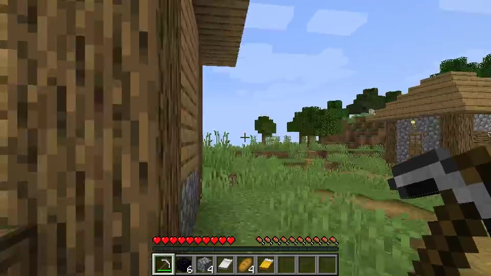
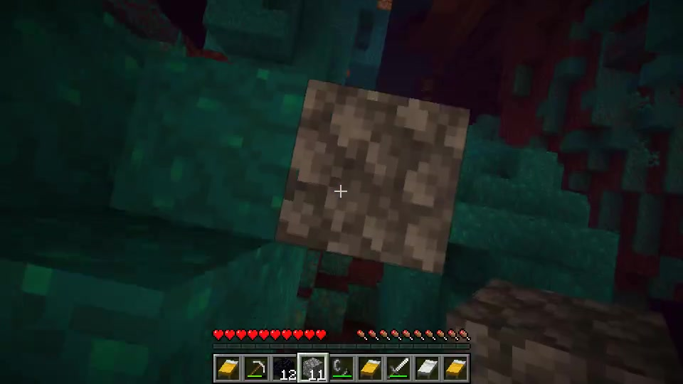
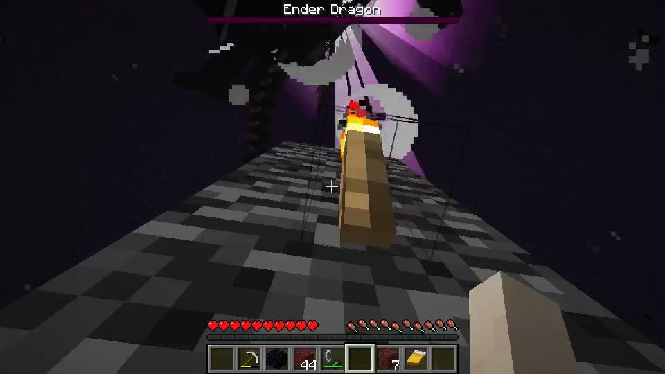
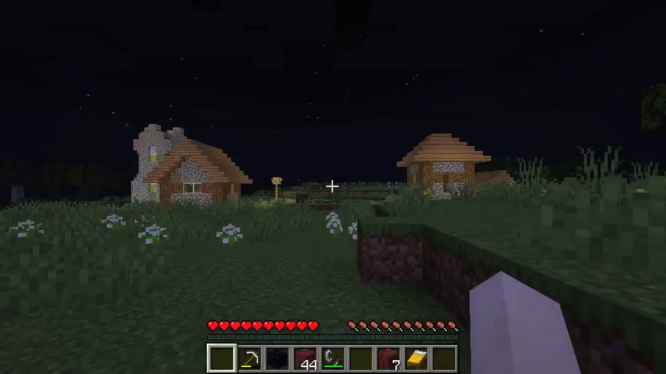

# Qwen 3.5 9B Minecraft Agent

[English](README.md) | [简体中文](README.zh-CN.md)

使用本地 Qwen 3.5 9B 同时负责 Minecraft Java 1.16.5 的规划与动作选择，提供可见的原生游戏窗口、连续录像和通关验证材料。

本项目基于 [rmalde/minecraft-agent](https://github.com/rmalde/minecraft-agent) 进行 Windows 适配。上游使用 Astra/Sol 规划、JEV 选择动作；本版本通过约束 JSON 输出的本地中继，将两个角色接入同一个 Qwen 服务。

## 项目范围与控制方式

智能体从全新世界、空背包开始，在**生存模式、和平难度**下收集物资，经下界移动，进入末地，用床击杀末影龙，最后通过返回传送门完成通关。

使用固定种子 `8398967436125155523` 和预先勘察的路线。该种子包含村庄物资和天然激活的末地传送门，因此不需要获取烈焰棒或合成末影之眼。已知坐标会提供给智能体。

Qwen 根据结构化游戏状态，从有限的合法动作中选择；Mineflayer 执行寻路和正常玩家交互。服务端只读传感器提供末影龙状态，供战斗动作判断时机。原生客户端负责录像，模型依据结构化状态决策，不通过截图识别或逐个键盘按键控制。成功说明模型能在这些条件下完成流程，不能据此推断随机种子的通用通关能力。

## 已验证的本地结果

保留的成功运行 `qwen-win-04` 结果如下：

| 项目 | 结果 |
| --- | --- |
| 规划模型 / 动作选择模型 | Qwen 3.5 9B / Qwen 3.5 9B |
| 实测权重 | GGUF Q4_K_M |
| 从录像开始到通关事件 | 13 分 55.391 秒 |
| 连续录像时长 | 14 分 3.500 秒 |
| 规划次数 / 动作选择次数 | 16 / 137 |
| 床爆炸次数 / 死亡次数 | 6 / 0 |
| 返回时生命值 | 20 / 20 |
| 失败动作 | 8 次，后续动作恢复并继续 |
| 本次运行中人工修复 / 重启 | 0 / 0 |
| 原始录像 | 960 × 540，20 fps，无音轨 |

18 项全流程验证和 8 项额外的路线、相机、界面检查全部通过。证据包含完整视频解码、世界存档中的末影龙状态、初始空背包、模型身份记录和运行源码哈希。这是一轮已验证的成功运行；此前失败试跑仍保留在本地，不能将这一结果当作成功率统计。

## 通关录像截图

以下画面截取自 `qwen-win-04` 的原始录像，时间戳以视频开始为起点。

| 村庄收集物资 · 01:00 | 下界行进 · 05:00 |
| --- | --- |
|  |  |
| 末影龙死亡动画 · 13:49 | 返回主世界 · 14:00 |
|  |  |

## 环境要求

- Windows 与 PowerShell；提供的 Windows 流程已在本机验证。
- Node.js 22 或更高版本、带 `pip` 的 Python，以及提供 `javac`、`jar` 的 Java 17 **JDK**。
- 已下载的 Qwen 模型，以及独立启动的本地 `llama-server`。项目不会下载模型或启动模型服务。
- 安装时能访问 npm、FFmpeg、Minecraft 二进制与资源、Maven 依赖的下载源。
- 默认模型端口 `8081`；项目组件需要空闲端口 `25576`、`25578`、`3078`、`3093`、`3099`。

实测使用 Qwen 3.5 9B Q4_K_M、RTX 4060 Laptop GPU（8 GiB 显存）、4096 上下文和一个推理槽位。其他量化或运行配置的资源需求、速度可能不同。

## Windows 快速开始

以下命令均在仓库根目录执行。

### 1. 安装依赖

```powershell
.\windows\setup.ps1
```

如果无法通过 `javac.exe` 找到 JDK，可先指定安装目录：

```powershell
$env:MC_JAVA_HOME = 'D:\Tools\jdk-17'
.\windows\setup.ps1
```

安装脚本会安装依赖、下载 Minecraft Java 1.16.5、编译只读传感器和原生录像适配器，并生成 `.runtime/config.json`。Python 包使用清华源；npm 与 Minecraft/Maven 依赖使用各自上游仓库。

### 2. 接受 Minecraft EULA

阅读 [Minecraft EULA](https://aka.ms/MinecraftEULA)。如果接受，将生成的 `server/eula.txt` 修改为包含：

```text
eula=true
```

未设置这一项时，启动脚本会拒绝启动服务端。

### 3. 启动本地模型

以下是已有 llama.cpp 环境的启动示例，请替换为自己的程序和模型路径：

```powershell
& 'D:\Tools\llama.cpp\llama-server.exe' `
  -m 'D:\Models\Qwen3.5-9B-Q4_K_M.gguf' `
  --alias qwen3.5-9b --host 127.0.0.1 --port 8081 `
  -c 4096 -np 1 -ngl auto

# 在另一个 PowerShell 窗口检查服务是否就绪：
Invoke-RestMethod 'http://127.0.0.1:8081/health'
```

模型服务需要支持 [qwen-relay.mjs](qwen-relay.mjs) 使用的 JSON Schema 响应格式。中继通过 `chat_template_kwargs.enable_thinking=false` 关闭思考模式，使用 temperature `0.7`、top-p `0.8`、top-k `20`。

默认地址为 `http://127.0.0.1:8081/v1`，模型别名为 `qwen3.5-9b`。如需其他本地地址或别名，在安装后修改 `.runtime/config.json` 的 `modelBase`、`model`，保留生成的 Java 与 FFmpeg 路径。监督进程还会检查模型服务的 `/health`，仅有兼容 API 而没有该端点的服务无法直接使用。中继仅接受回环地址。重新安装会重置这些生成配置。

### 4. 开始带录像的运行

```powershell
.\windows\start.ps1 -RunId qwen-demo-01 -MaxMinutes 60
```

每次使用新的运行名称。启动脚本会创建全新世界，启动服务端、中继、智能体和原生客户端，并录制游戏帧缓冲。启动完成后会出现可见的 Minecraft 窗口。可在 `http://127.0.0.1:3078` 查看进度，在 `http://127.0.0.1:3078/view` 查看原生画面。

结束后监督进程会保存世界、完成视频写入、停止自己的项目进程，并验证通关证据。共享 Qwen 服务会继续运行。提前停止或失败的运行仍保留，不会标记为通关。

如需提前停止：

```powershell
.\windows\stop.ps1
```

停止会等待当前动作边界、世界保存和录像收尾。证据写入期间，避免强制关闭编码器或服务端。

## 录像、日志与验证

| 位置 | 内容 |
| --- | --- |
| `runs/<run>/full-playthrough.mp4` | 连续原生游戏录像 |
| `runs/<run>/events.jsonl` | 模型请求与响应、动作选择、执行结果和事件 |
| `runs/<run>/run-config.json` | 运行条件、模型身份和源码哈希 |
| `runs/<run>/status.json` | 进度状态 |
| `runs/<run>/victory.json` | 出现通关时的末影龙死亡与返回事件证据 |
| `runs/<run>/verification.json` | 世界存档与录像验证结果 |
| `runs/<run>/source/` | 本轮运行冻结的源码快照 |
| `server/<run>/` | 世界存档，包含末影龙战斗状态 |
| `.runtime/runs/<run>/` | 进程日志和监督进程诊断 |

仅有 `victory.json` 不足以确认完整通关，需要同时检查验证报告、存档中的末影龙状态和完整录像。运行停止后，可以重新验证：

```powershell
$env:FFMPEG_PATH = (Get-Content .runtime/config.json -Raw | ConvertFrom-Json).ffmpeg
node verify-run.mjs qwen-demo-01 qwen-demo-01
```

`qwen-win-04` 另外在本地生成了 `full-playthrough-with-english-logs.mp4`。上方是游戏画面，下方是按时间同步的英文日志，包含全部规划、137 次动作选择与执行结果，以及 8 次失败动作。规格为 1280 × 1080、20 fps，保留原始时长和 16,870 帧。高频相机、位置遥测体现在状态栏，并保留在原始 JSONL 中。完整解码和 11 项媒体、日志验证全部通过。

对应英文文本、字幕轨、覆盖报告和哈希保存在同一目录。**`start.ps1` 生成原始录像，不会自动生成英文日志合成视频。**视频、证据压缩包和导出文件均被 Git 忽略，全新克隆不包含这些材料。

录像读取游戏帧缓冲，不录制桌面，也没有音轨。公开前仍应检查可见文字和元数据。原始证据包可能包含本地路径与进程配置，需要单独做隐私检查。

## 存储位置与可恢复清理

新安装的项目依赖、缓存、临时文件、Minecraft 资源、世界和录像均位于仓库目录内。希望放在哪个磁盘，就把仓库放在哪个磁盘。已有 Node/Python/Java 环境和外部模型会被复用。安装时可能校验并复制已有 `.minecraft` 资源，但不会修改原有游戏安装与设置。

安装流程不进行全局 npm/Python 包安装，不修改注册表，不创建服务或计划任务。Windows 与显卡驱动仍可能在项目外产生系统缓存或分页文件活动。

```powershell
.\windows\clean.ps1 -WhatIf       # 仅预览，不移动文件
.\windows\clean.ps1               # 保留 runs 与录像
.\windows\clean.ps1 -IncludeRuns  # 同时移动 runs 与录像
```

清理脚本检查项目进程已停止，并验证目标范围，然后将生成文件移动到 `.trash/cleanup-<timestamp>/`。源码、外部运行环境和模型会保留。默认保留 `runs/`，但会移动服务端世界存档和运行时日志；需要完整证据时应先归档它们。文件仍可从 `.trash` 恢复，只有自行清空后才会释放空间。重新安装可恢复依赖。

## 开发与常见问题

使用 `npm test` 运行已有自动化检查。原生渲染、移动、背包交互、战斗和录像仍需要实际 Minecraft 运行验证。

- **没有游戏窗口：**查看 `.runtime/runs/<run>/supervisor.log` 和客户端、服务端的 stderr 日志。成功运行收尾后会自动关闭原生客户端。
- **模型报错：**检查 `/health`、模型别名和 `.runtime/config.json`，先启动模型服务，再启动项目。
- **端口占用：**先停止占用进程或上一轮运行。目前监督进程使用固定的项目端口。
- **Java 编译失败：**确认安装的是 JDK，而不是 JRE，并检查 `MC_JAVA_HOME`。
- **下载失败：**恢复包与游戏资源仓库的网络访问后，重新运行安装。
- **运行未完成：**保留日志与录像，检查失败动作和验证结果，不将其描述为完整通关。

## 项目结构与上游致谢

- [windows/](windows/)：Windows 安装、进程监督、状态显示、停止和清理。
- [qwen-relay.mjs](qwen-relay.mjs)：本地模型请求、输出约束和响应验证。
- [nether-agent.mjs](nether-agent.mjs)：游戏循环和阶段推进。
- [optimization/nether/config.json](optimization/nether/config.json)：预先勘察的种子路线。
- [native-client/](native-client/)：原生渲染、界面同步和录制。
- [observer/](observer/)：末影龙只读传感器。
- [verify-run.mjs](verify-run.mjs)：录像与世界存档验证。

上游云端模型代码保留在 `models.mjs` 和 `model-relay.mjs`，使用 OpenRouter 与 Google Secret Manager，需要独立配置凭据。Windows Qwen 流程不需要这些凭据。上游 macOS 启动、编译脚本与已验证的 Windows 流程分别使用。

感谢 [Minecraft Agent](https://github.com/rmalde/minecraft-agent)、[Mineflayer](https://github.com/PrismarineJS/mineflayer)、[Mineflayer Pathfinder](https://github.com/PrismarineJS/mineflayer-pathfinder) 和 [llama.cpp](https://github.com/ggml-org/llama.cpp)。
